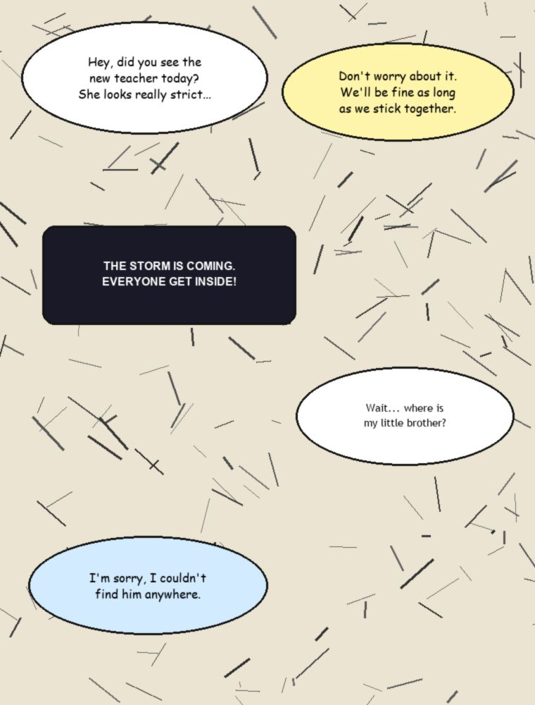
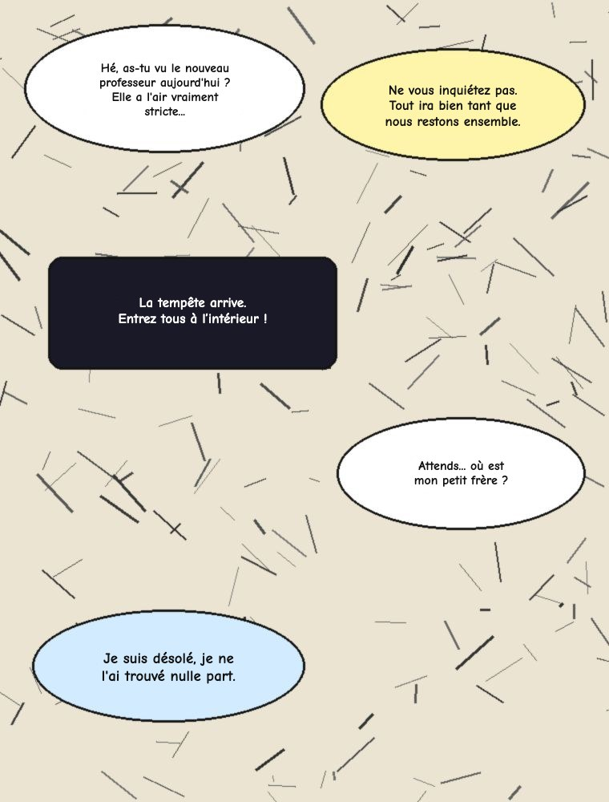

# Traducteur de bulles

Traduis gratuitement le texte des bulles de BD, manga et webtoons, sur ordinateur et sur téléphone.
Sans compte, sans pub, sans clé d'API. *English below.*

**Site : https://no6b.github.io/traducteur-bulles/**

| Avant | Après |
|---|---|
|  |  |

## Deux façons de l'utiliser

### Sur téléphone (Android, iPhone) : l'application web
Ouvre https://no6b.github.io/traducteur-bulles/app/ puis installe-la sur l'écran d'accueil.
Choisis une image ou une capture d'écran (sur Android : « Partager » vers « Bulles ») ; l'image revient
traduite, le texte d'origine effacé, prête à enregistrer.

### Sur ordinateur : l'extension (Chrome, Brave, Edge, Opera ; Firefox en préparation)
1. Télécharger le `.zip` de la [dernière version](https://github.com/NO6B/traducteur-bulles/releases/latest) et le décompresser.
2. Ouvrir `chrome://extensions` (ou `brave://extensions`…) et activer le « Mode développeur ».
3. « Charger l'extension non empaquetée » et choisir le dossier décompressé.

Utilisation :
- Une image : clic droit, « Traduire les bulles de cette image ».
- Toute la page : icône de l'extension ou **Alt+T**. Les images sont traduites en avance pendant la lecture.
- Automatique : cocher « Traduire automatiquement sur ce site » dans la fenêtre de l'extension.
- Cliquer sur une bulle traduite affiche ou masque l'original.

## Fonctionnement

- Lecture du texte (OCR) en local avec Tesseract.js : une 1re lecture repère les bulles, une 2e relit
  chaque bulle agrandie et contrastée et rattrape les lignes oubliées.
- Nettoyage du texte (majuscules de BD, symboles parasites, césures).
- Toutes les bulles d'une image sont traduites ensemble (le traducteur a le contexte), via Google Traduction
  (service gratuit, sans clé) ou MyMemory, avec nouvelles tentatives et bascule automatique.
- Cache des pages déjà traduites, couleur des bulles reprise, police BD (Comic Neue).

## Limites

- Très bon sur du texte imprimé net (scans anglais, webtoons), moyen sur le japonais vertical et les polices
  manuscrites ou très stylisées. Des confusions restent possibles.
- Le texte des bulles est envoyé au service de traduction choisi ([confidentialité](https://no6b.github.io/traducteur-bulles/privacy.html)).
- Extension : images dessinées dans un `<canvas>` et images de fond CSS non prises en charge.
- Pas d'extension pour Safari sur iPhone : utiliser l'application web.

## Développement

```
app/            application web (PWA) : téléphone et ordinateur
engine/         moteur commun : ocr.js (Tesseract), translate.js, render.js (effacement + texte)
background.js   extension : menus, OCR (document offscreen sous Chrome, page de fond sous Firefox), cache
content.js      extension : affichage des traductions sur la page
scripts/package.sh   fabrique dist/traducteur-bulles-<version>.zip pour les boutiques
STORE.md        textes et étapes de publication (Chrome Web Store, Edge, Firefox)
```

Licences tierces : Tesseract.js (Apache 2.0), Comic Neue (SIL OFL 1.1, voir `fonts/OFL-LICENSE.txt`).

---

## English

Free translation of speech bubbles in comics, manga and webtoons, on desktop and phone. No account, no ads, no API key.

- **Phone (Android, iPhone):** open https://no6b.github.io/traducteur-bulles/app/, add it to your home screen, pick a
  screenshot (or share it to “Bulles” on Android) and get the translated image back.
- **Desktop extension (Chrome, Brave, Edge, Opera):** download the zip from the
  [latest release](https://github.com/NO6B/traducteur-bulles/releases/latest), unzip, enable Developer mode on the
  extensions page, then “Load unpacked”. Right-click an image, or press Alt+T for the whole page.

Text recognition runs locally (Tesseract.js); only the bubble text is sent to the translation service (Google Translate or MyMemory).
